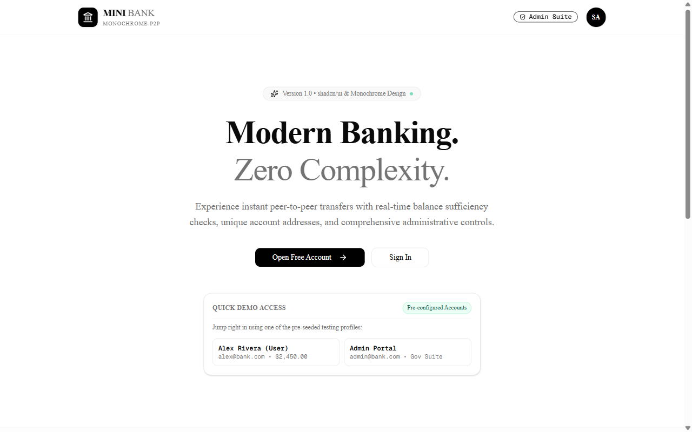
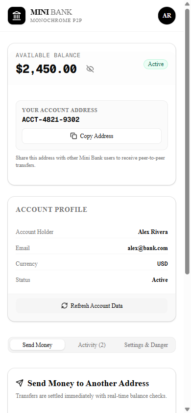
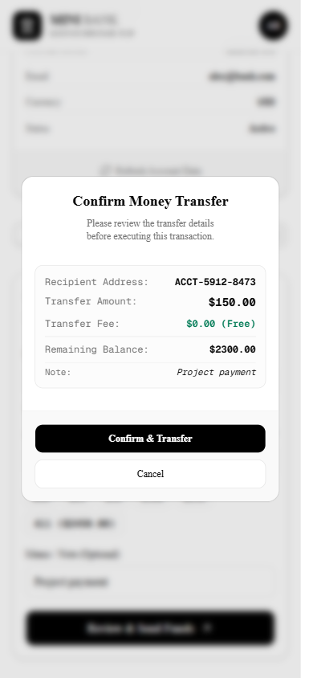
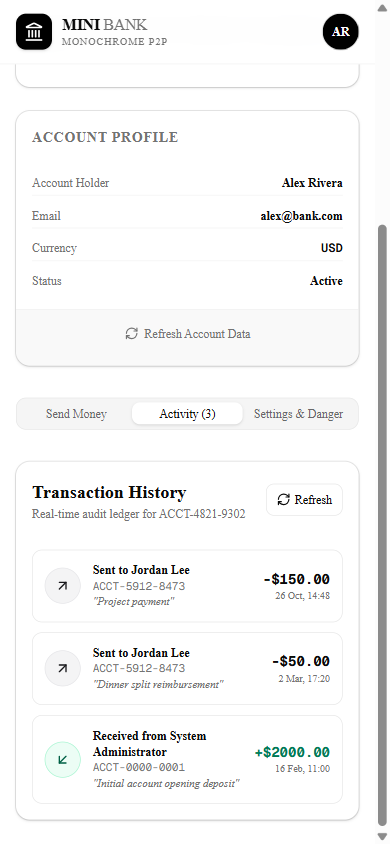
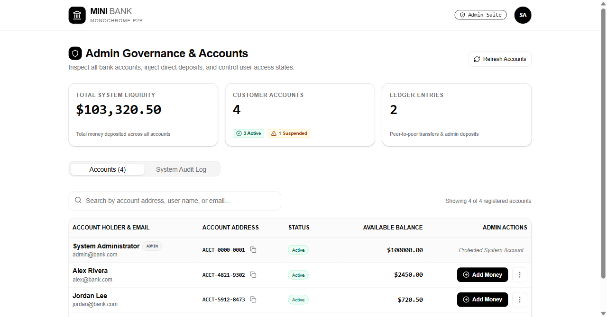
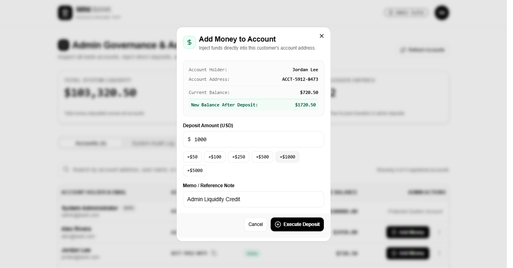
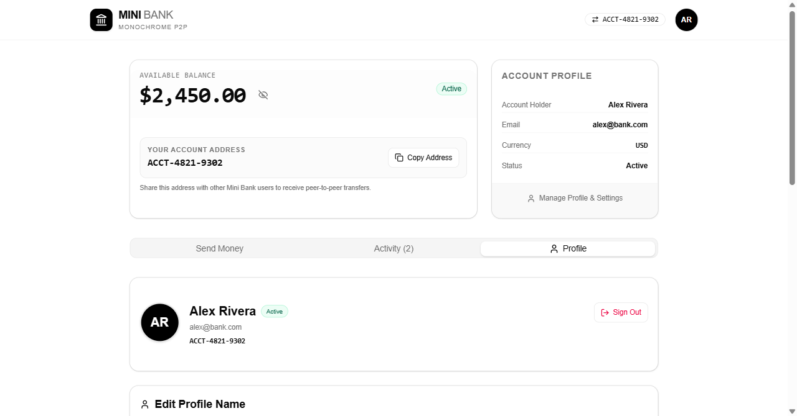
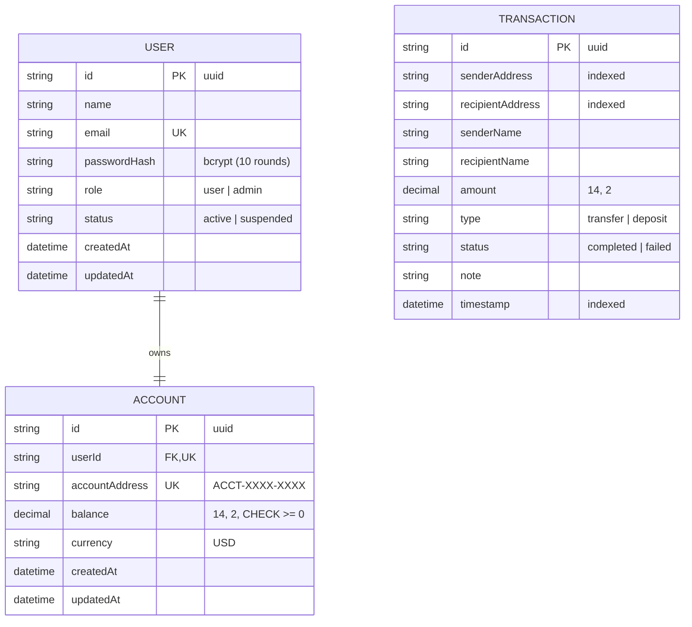

# 🏦 Mini Bank

> **A modern, mobile-first financial management platform built with Next.js, shadcn/ui, PostgreSQL 16 in Docker, and Prisma ORM.**  
> Featuring a minimalist monochrome aesthetic, Apple typography (San Francisco), ACID-compliant peer-to-peer transfers, and comprehensive administrative governance.

---

## 📸 Visual Showcase

<div align="center">
  
  <p><em>Modern monochrome landing page featuring instant testing profiles and Apple typography</em></p>
</div>

### Mobile-First Experience & Banking Flows

| User Dashboard | Transfer Confirmation | Transaction Activity |
| :---: | :---: | :---: |
|  |  |  |
| *Real-time balance, copyable address* | *Pre-flight verification & summary* | *Full audit ledger with semantic status* |

### Admin Governance & Treasury Suite

| Admin Dashboard | Treasury Deposit Modal | Profile Management |
| :---: | :---: | :---: |
|  |  |  |
| *System liquidity & account directory* | *Live balance preview & direct credit* | *Edit profile name, security & deletion* |

---

## ✨ Key Features

- **📱 Mobile-First Native Feel**: Responsive layout engineered with shadcn/ui primitive components, providing an app-like experience on smartphones that scales effortlessly to desktop screens.
- **🍎 Apple Typography**: Configured with Apple's San Francisco font stack (`-apple-system`, `SF Pro Text`, `SF Pro Display`) for a clean, premium visual aesthetic.
- **🎨 Monochrome Palette with Soft Semantic Badges**: High-contrast black-and-white theme augmented by subtle, soft status indicators:
  - 🟢 **Light Green**: Completed transfers, active status, successful deposits.
  - 🟡 **Light Yellow**: Account suspension notices, critical warnings.
  - 🔴 **Light Red**: Insufficient funds, input errors, irreversible deletion prompts.
- **💸 Address-Based P2P Transfers**: Direct transfers using formatted addresses (`ACCT-XXXX-XXXX`) with real-time pre-flight balance sufficiency checks and instant debit/credit execution.
- **🛡️ ACID Financial Transactions**: Powered by PostgreSQL 16 and Prisma `$transaction`. Debiting sender, crediting recipient, and recording the ledger entry execute atomically.
- **🚫 Overdraft & Double-Spending Protection**: Database-level check constraint (`CHECK ("balance" >= 0.00)`) combined with row-locking guarantees that balances cannot drop below zero under concurrent transfer attempts.
- **👑 Admin Governance Portal**: Centralized suite for administrators to inspect all registered accounts, inject treasury liquidity, toggle user suspension, and review global system logs.
- **👤 Profile & Security Controls**: View legal name, update profile name, change password with current-hash verification, and safely delete accounts with cascading cleanup.

---

## 🏗️ Architecture & Database Design



---

## ⚡ Quick Start

### Option 1: One-Click Startup Script (Recommended)

The project includes unified launch scripts that verify prerequisites, start the PostgreSQL container, apply migrations, seed demo accounts, and launch the app:

#### On Linux / macOS / Git Bash / WSL:
```bash
chmod +x run.sh
./run.sh
```

#### On Windows Command Prompt:
```cmd
run.bat
```

#### On Windows PowerShell:
```powershell
.\run.ps1
```

---

### Option 2: Manual Setup

1. **Clone the repository**:
   ```bash
   git clone https://github.com/arezkisenouci/mini-bank.git
   cd mini-bank
   ```

2. **Install dependencies**:
   ```bash
   npm install
   ```

3. **Configure Environment Variables**:
   Copy `.env.example` to `.env`:
   ```bash
   cp .env.example .env
   ```

4. **Launch PostgreSQL via Docker Compose**:
   ```bash
   npm run docker:up
   ```

5. **Generate Prisma Client & Apply Migrations**:
   ```bash
   npm run db:generate
   npm run db:migrate
   ```

6. **Seed the Database with Demo Data**:
   ```bash
   npm run db:seed
   ```

7. **Start the Next.js Server**:
   ```bash
   npm run dev
   ```
   Open [http://localhost:3000](http://localhost:3000) in your browser.

---

## 🔑 Pre-Seeded Testing Accounts

The seeder initializes the database with four accounts covering all roles and edge cases:

| Role | Email | Password | Starting Balance | Account Address | Status |
| :--- | :--- | :--- | :--- | :--- | :--- |
| **System Administrator** | `admin@bank.com` | `admin123` | **$100,000.00** | `ACCT-0000-0001` | Active |
| **Customer (Alex)** | `alex@bank.com` | `password123` | **$2,450.00** | `ACCT-4821-9302` | Active |
| **Customer (Jordan)** | `jordan@bank.com` | `password123` | **$720.50** | `ACCT-5912-8473` | Active |
| **Customer (Sam)** | `sam@bank.com` | `password123` | **$150.00** | `ACCT-1204-6731` | *Suspended (Read-Only)* |

---

## 🛠️ Available Scripts

| Script | Command | Purpose |
| :--- | :--- | :--- |
| `npm run dev` | `next dev` | Start development server with Turbopack |
| `npm run build` | `next build` | Create optimized production build |
| `npm run start` | `next start` | Run production server |
| `npm run docker:up` | `docker compose up -d` | Start PostgreSQL 16 container |
| `npm run docker:down` | `docker compose down` | Stop PostgreSQL container safely |
| `npm run docker:logs` | `docker compose logs -f` | Tail live PostgreSQL logs |
| `npm run db:migrate` | `prisma migrate dev` | Apply schema migrations to PostgreSQL |
| `npm run db:generate` | `prisma generate` | Regenerate Prisma client types |
| `npm run db:seed` | `prisma db seed` | Seed database with initial demo accounts |
| `npm run db:studio` | `prisma studio` | Open visual Prisma database GUI |

---

## 🔒 Financial Integrity & Invariant Guarantees

- **No Floating-Point Arithmetic**: All monetary quantities are modeled as `Decimal(14, 2)` across Prisma and PostgreSQL, avoiding IEEE-754 decimal drift.
- **Constraint Enforcement**: Negative balance mutations are rejected at the database engine level via PostgreSQL `CHECK ("balance" >= 0.00)`.
- **Atomic Concurrency Protection**: Multi-step transfers (debit sender, credit recipient, record transaction) are wrapped in `db.$transaction` to eliminate race conditions and double-spending vulnerabilities.
- **Secure Authentication**: Passwords hashed with `bcryptjs` (salt rounds: 10), stored in PostgreSQL, and verified through secure HTTP-only session cookies.

---

## 📄 License

This project is licensed under the MIT License.
