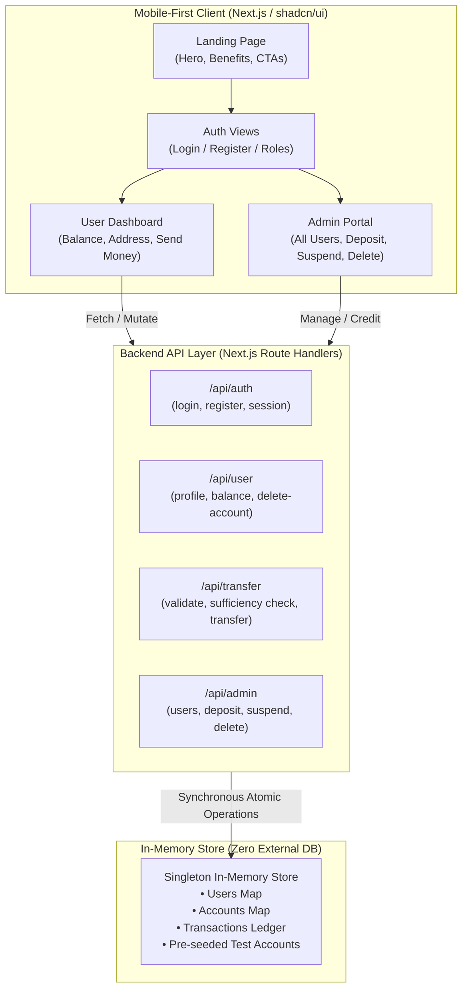

# Project Architecture & Phases Implementation Plan
## Mini Bank Web Application (shadcn/ui • Mobile-First • Full-Stack)

---

## 1. Project Vision & Architectural Overview

The **Mini Bank** web application is a streamlined, professional financial management platform built with a high-contrast, black-and-white minimalist design aesthetic, accented with soft status indicators (light green for success, light yellow for warnings, light red for errors). 

The platform is designed **mobile-first**, providing a responsive native-app-like experience on smartphones that seamlessly expands to larger tablet and desktop screens. It delivers both customer banking services (balance checking, address-based peer-to-peer transfers, account self-deletion) and administrative governance (user tracking, account deposits, suspension, and account deletion).

### Core Architectural Decisions:
- **Framework**: **Next.js (App Router, React 19 / TypeScript, Tailwind CSS)** providing a unified full-stack architecture with frontend layouts and backend Route Handlers (`/api/*`).
- **UI System**: **shadcn/ui** exclusively. All interfaces will strictly employ official shadcn components (`npx shadcn@latest add ...`), ensuring accessible, production-grade components without bespoke reinvented controls.
- **Backend Storage Layer**: **In-Memory Thread-Safe State Engine** (Frontend + Backend only). As per specifications, **no database is included at this stage**. The backend leverages an isolated in-memory service layer with typed repositories, pre-seeded accounts, and transactional consistency checks. This establishes an interface-compatible foundation ready for future database integration without UI or API refactoring.
- **Design System & Palette**:
  - **Dominant**: Monochrome (Black `#000000`, Off-Black `#09090B`, Deep Charcoal `#18181B`, Neutral Border `#27272A`, Pure White `#FFFFFF`).
  - **Success / Positive**: Light Green (`bg-emerald-50 text-emerald-800 border-emerald-200 dark:bg-emerald-950/40 dark:text-emerald-300 dark:border-emerald-800`).
  - **Warning / Alert**: Light Yellow (`bg-amber-50 text-amber-800 border-amber-200 dark:bg-amber-950/40 dark:text-amber-300 dark:border-amber-800`).
  - **Error / Destructive**: Light Red (`bg-rose-50 text-rose-800 border-rose-200 dark:bg-rose-950/40 dark:text-rose-300 dark:border-rose-800`).

---

## 2. System Architecture & Data Flow

---

## 3. Comprehensive Phases Plan

### Phase 1: Project Initialization & shadcn/ui Setup
**Goal**: Establish a Next.js App Router codebase, configure Tailwind CSS, initialize the official shadcn/ui CLI, and import all essential shadcn components.

- [x] **1.1 Next.js App Router Setup**
  - Initialize Next.js project with TypeScript, ESLint, and Tailwind CSS.
  - Configure `tsconfig.json` path aliases (`@/*`).
- [x] **1.2 shadcn/ui Installation & Configuration**
  - Run `npx shadcn@latest init` configured with the **Neutral / Zinc** theme and CSS variables.
  - Configure root CSS variables for high-contrast black/white styling and subtle status accents (light red, light yellow, light green).
- [x] **1.3 Official shadcn Components Installation**
  - Install required shadcn primitives via CLI:
    - Layout & Structure: `card`, `separator`, `tabs`, `sheet`, `skeleton`
    - Forms & Actions: `button`, `input`, `label`, `form`, `dropdown-menu`
    - Modals & Notifications: `dialog`, `alert-dialog`, `badge`, `alert`, `sonner` (Toast)
    - Data Presentation: `table`, `avatar`
- [x] **1.4 Mobile-First Responsive Shell**
  - Create the root layout (`app/layout.tsx`) with font configuration and Sonner toaster integration.
  - Implement mobile-friendly header and navigation drawer/sheet with high-contrast monochrome branding.

---

### Phase 2: In-Memory Backend Engine & API Architecture (No Database)
**Goal**: Implement an in-memory data store, domain models, seed dataset, and RESTful route handlers to power all business logic without any external database.

- [x] **2.1 TypeScript Domain Models**
  - `User`: ID, name, email, password (hashed/mock-verified), role (`'user' | 'admin'`), status (`'active' | 'suspended'`), createdAt.
  - `Account`: ID, userId, accountAddress (formatted: `ACCT-XXXX-XXXX`), balance (decimal/number), currency (`'USD'`).
  - `Transaction`: ID, senderAddress, recipientAddress, amount, type (`'transfer' | 'deposit'`), status (`'completed' | 'failed'`), timestamp, note.
- [x] **2.2 In-Memory Bank Store (Thread-Safe / Node Singleton)**
  - Create `lib/store/bank-store.ts` managing:
    - User registration and retrieval by ID / Email.
    - Account address generation and lookup.
    - Atomic transfer logic:
      - Validates recipient address exists.
      - Checks if sender account is active (not suspended).
      - Checks sufficiency: `sender.balance >= transferAmount`.
      - Deducts from sender and credits recipient atomically.
      - Appends transaction record.
    - Admin operations:
      - Direct balance deposit to any account address.
      - Account status toggle (`active` <-> `suspended`).
      - Account deletion (user and associated account removal).
  - Pre-seed store with:
    - 1 Admin account (`admin@bank.com`)
    - 2-3 Test user accounts with starting balances (e.g., `$1,500.00`, `$450.00`, `$0.00`) and unique addresses for immediate testing.
- [x] **2.3 API Route Handlers**
  - `/api/auth/login`: Authenticate email/password and return user session & role.
  - `/api/auth/register`: Create new user, auto-generate account address, assign initial welcome balance ($100).
  - `/api/user/me`: Return current user profile, account address, current balance, and transaction history.
  - `/api/user/delete`: Allows user to permanently delete their own account.
  - `/api/transfer`: Validates recipient address, checks balance sufficiency, executes transfer, returns updated balance and transaction status.
  - `/api/admin/users`: List all users with account addresses, balances, and statuses.
  - `/api/admin/deposit`: Add funds to any specified user account address.
  - `/api/admin/status`: Update user account status (suspend / reactivate).
  - `/api/admin/delete`: Administrative deletion of any user account.

---

### Phase 3: Public Landing Page & Authentication (Mobile-First)
**Goal**: Build a landing page and authentication flow using shadcn/ui components with responsive mobile layouts and crisp monochrome styling.

- [x] **3.1 Mobile-First Landing Page (`app/page.tsx`)**
  - **Header**: Minimalist bank logo mark, navigation links, quick action buttons ("Sign In" / "Open Account").
  - **Hero Section**: Bold typography ("Modern Banking, Simplified"), concise value proposition, primary call-to-action button, preview badge.
  - **Key Features Section**:
    - Instant Account Addresses (`ACCT-XXXX-XXXX`).
    - Real-Time Zero-Fee Peer-to-Peer Transfers.
    - Account Security & Governance Controls.
  - **Quick Demo Bar**: Instant switch/demo accounts indicator for testing without typing.
  - **Footer**: Mobile-optimized clean monochrome footer.
- [x] **3.2 Authentication Views (`app/login/page.tsx`, `app/register/page.tsx`)**
  - **Login Card**:
    - Input fields for Email and Password using shadcn `Input`, `Label`, and `Button`.
    - One-click "Demo User Login" and "Demo Admin Login" buttons for testing ease.
    - Event feedback using light red alert for invalid credentials, light green toast on successful authentication.
  - **Register Card**:
    - Input fields: Full Name, Email, Password, Confirm Password.
    - Information notice: Informs user that an instant account address and starting balance will be provisioned.
    - Form submission validation with inline error states (light red text and borders).

---

### Phase 4: User Portal (Customer Experience)
**Goal**: Implement the primary customer interface for checking balances, viewing account addresses, executing safe peer-to-peer transfers with sufficiency checks, and deleting accounts.

- [x] **4.1 Mobile-First Navigation & Account Summary**
  - Mobile bottom navigation bar / sticky top bar with user avatar, active status badge, and sign-out action.
  - **Account Card (shadcn `Card`)**:
    - Display current Account Balance formatted in bold currency.
    - Eye toggle icon to show/hide balance.
    - Account Address display (`ACCT-XXXX-XXXX`) with a one-click copy-to-clipboard button and light green confirmation tooltip/toast.
    - Status Badge: Light green `Active` or light yellow `Suspended` badge.
- [x] **4.2 Send Money Module (Peer-to-Peer Transfer)**
  - Form built with shadcn `Card`, `Input`, `Label`, `Button`.
  - Recipient Address input with live formatting.
  - Amount input with quick-select chips (`$25`, `$50`, `$100`, `$500`, `Max`).
  - **Sufficiency Engine & Real-Time Feedback**:
    - Real-time balance check before submission.
    - If `amount > balance`: Displays an inline light red alert (`Insufficient funds. Available: $XXX.XX`) and disables submission.
    - If `amount <= balance`: Enables transfer button.
    - If account is suspended: Displays a light yellow warning banner informing the user that outgoing transfers are paused.
  - **Confirmation Dialog (shadcn `AlertDialog`)**:
    - Opens modal showing recipient address, transfer amount, fee ($0.00), and remaining balance after transfer.
    - Confirm button executes transfer; displays light green Sonner toast on success.
- [x] **4.3 Transaction History**
  - Clean card-based list (optimized for mobile) showing recent incoming and outgoing transactions.
  - Amount indicators: `+$XX.XX` with light green accent, `-$XX.XX` with neutral dark accent.
  - Details: Recipient/sender address, timestamp, status badge.
- [x] **4.4 Account Danger Zone (Self-Account Deletion)**
  - Profile settings section with account info.
  - "Delete Account" button triggering a shadcn `AlertDialog`.
  - Clear warning: "This action cannot be undone. All remaining funds will be forfeited."
  - Double-confirmation prompt; upon deletion, purges session and redirects to landing page with light yellow notice.

---

### Phase 5: Admin Management & Governance Suite
**Goal**: Deliver an administrative dashboard to inspect all registered accounts, inject deposits, toggle account suspensions, and remove users.

- [x] **5.1 Admin Metrics & Overview Dashboard**
  - Stat cards (shadcn `Card`):
    - Total System Accounts
    - Total Liquidity in Circulation
    - Active Accounts vs. Suspended Accounts
- [x] **5.2 User Accounts Management Table**
  - Mobile-responsive view: Stacked cards on mobile devices, full shadcn `Table` on tablets/desktops.
  - Column / Data points:
    - User Name & Email
    - Unique Account Address (copyable)
    - Current Balance
    - Account Status (`Active` in light green badge, `Suspended` in light yellow badge)
    - Action dropdown (`DropdownMenu`):
      - "Deposit Money"
      - "Suspend Account" / "Reactivate Account"
      - "Delete Account" (Destructive light red)
- [x] **5.3 Admin Deposit Action**
  - Modal triggered via shadcn `Dialog`.
  - Displays selected user's name and account address.
  - Amount input with validation (`amount > 0`).
  - Optional deposit note / reference.
  - On submit: Credits account immediately, generates transaction entry, displays light green success notification.
- [x] **5.4 Account Suspension & Deletion Controls**
  - **Suspend / Reactivate**: Instant status toggle with light yellow warning alert dialog before confirmation.
  - **Delete Account**: Destructive action requiring confirmation via shadcn `AlertDialog`. Permanently deletes the account and updates all metrics in real time.
- [x] **5.5 System-Wide Audit Ledger**
  - Chronological list of all transfers, deposits, and status changes across the platform for administrative audit.

---

### Phase 6: Edge Cases, Quality Assurance & Mobile Polish
**Goal**: Verify all validation rules, edge cases, visual styling consistency, and responsiveness across small screens.

- [x] **6.1 Transfer Edge Cases & Integrity Verification**
  - Prevent transfers to self (sender address == recipient address).
  - Prevent negative or zero amounts (`amount <= 0`).
  - Prevent decimal precision anomalies (enforce 2 decimal places max).
  - Prevent transfers from suspended accounts.
  - Prevent transfers to non-existent account addresses.
  - Verify that simultaneous or rapid transfers cannot overdraft account below $0.00.
- [x] **6.2 Visual Design & Notification Audit**
  - Verify strict black-and-white base styling across all dark and light contexts.
  - Verify semantic colors:
    - Light Green: Transfer success, deposit success, active status.
    - Light Yellow: Account suspension notice, warning before deletion, max balance alerts.
    - Light Red: Insufficient funds, invalid address, server error, destructive actions.
  - Audit mobile viewport sizes (360px, 390px, 414px) ensuring no horizontal overflow and touch targets >= 44px.
- [x] **6.3 End-to-End Walkthrough Verification**
  - Register new user -> verify address generation -> verify initial balance.
  - Send money from User A to User B -> verify A's balance decreases and B's balance increases.
  - Admin view -> deposit funds into User B -> verify balance updates.
  - Admin suspend User A -> User A attempts transfer -> verify transfer blocked with warning.
  - User B deletes account -> verify account removed from admin list.

---

## 4. shadcn/ui Component Inventory Mapping

| Feature Area | Required shadcn Components | Specific Purpose |
| :--- | :--- | :--- |
| **Shell & Layout** | `Card`, `Separator`, `Sheet`, `Skeleton` | Mobile navigation drawer, content cards, visual grouping, skeleton loaders |
| **Landing & Auth** | `Button`, `Input`, `Label`, `Tabs` | Hero CTA, login/register tabs, high-contrast monochrome inputs |
| **User Dashboard** | `Card`, `Badge`, `Avatar`, `Button` | Balance display card, status badges, copy-address action |
| **Transfer System** | `Input`, `Label`, `AlertDialog`, `Alert` | Amount & address input, sufficiency alerts (light red), confirmation modal |
| **Notifications** | `Sonner` (Toaster), `Alert` | Global light-green / light-yellow / light-red event notifications |
| **Admin Panel** | `Table`, `DropdownMenu`, `Dialog`, `Badge` | Responsive user directory, quick deposit dialog, status toggles |
| **Account Deletion** | `AlertDialog`, `Button` | Destructive confirmation dialogue with light-red alerts |

---

## 5. Summary of Scope Boundaries

> [!IMPORTANT]
> **Strict Scope Adherence**:
> 1. **No Database Configuration**: All persistence is managed in a robust, in-memory Node singleton store. No database setup, migrations, ORM, or containerized DB services are included in this phase.
> 2. **shadcn/ui Only**: No arbitrary third-party component libraries or custom non-shadcn primitive replacements.
> 3. **Design System**: Strict monochrome base (black/white) with light red, yellow, and green reserved strictly for semantic event statuses.
> 4. **Mobile First**: All views are designed from small screen mobile viewports (360px+) upwards to desktop.
